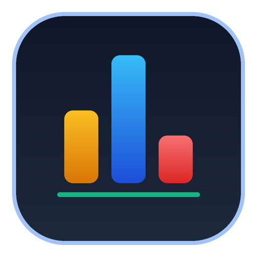

<p align="center">
  
</p>

# Daily CF — Chrome Extension

**Repository:** [Daily CF on GitHub](https://github.com/itsR0sen/Extensions/tree/4931fe679f217e66cd7fe26cb5d8bba00f854cf0/Daily%20CF)  
**Author:** [itsR0sen](https://github.com/itsR0sen)  
**Version:** 1.1 (Manifest V3)

---

## Overview

**Daily CF** is a lightweight, self-contained Chrome extension engineered to streamline problem-solving workflows on [Codeforces](https://codeforces.com/). It eliminates decision fatigue by curating tailored daily problem sets directly into the native Codeforces interface, accompanied by habit tracking, contest countdowns, and distraction-free blind practice modes.

---

## Key Features

### 1. Tailored Daily Problem Sets
- **Difficulty Modes**:
  - **Standard**: Problems tuned around your current rating ($\pm 100$).
  - **Warm-up**: Fast practice with easier problems ($-300$..$-100$).
  - **Challenge**: Stretch problems to level up ($+100$..$+300$).
  - **Custom Bounds**: Set explicit minimum and maximum rating limits (e.g. 1400–1800).
- **Topic & Tag Selection**: Filter specifically for Dynamic Programming, Graphs, Math, Greedy, Trees, Data Structures, Binary Search, Geometry, and more.
- **Problem Set Sizes**: Generate sets of 1, 3, 5, 8, or 10 problems per day.

### 2. In-Page Codeforces Integration
- **Native Look & Feel**: Matches Codeforces sidebox architecture (`roundbox`, `rtable`, `.caption.titled`, `.top-links`) with zero layout shift.
- **Tooltip Tag Display**: Topic tags stay tucked away as clean tooltips on hover, keeping table rows neat and uncluttered.
- **Problem Reroll (↻)**: Hover over any problem number to reveal an instant reroll button that replaces only that problem while strictly preserving your selected tag and rating target.
- **Solve Detection**: Solved problems are instantly marked with a green checkmark and struck-through title upon submission verdict.

### 3. Blind Practice Mode
- Mask problem ratings in both the extension popup and the in-page table (`••••`).
- Eliminates psychological rating bias during practice.
- Hover or click individual rating pills to peek when desired.
- Toggle anytime via the bottom table button `[ Ratings: Hidden / Visible ]`.

### 4. Contest Calendar & Google Calendar Export
- Live countdown to the next official Codeforces contest.
- Expandable contest drawer on Codeforces pages showing the top upcoming rounds.
- 1-click **Add to Cal** buttons in the popup to schedule contest reminders in Google Calendar.

### 5. Habit Tracking & Profile Analytics
- Real-time solve streak calculation (current consecutive active days and all-time max streak).
- Total problems solved counter and all-time peak rating display.
- Dynamic handle and rank badge rendering in official Codeforces rank colors (Grandmaster, Master, Expert, Specialist, Pupil, Newbie).
- Instant offline avatar caching with fallback proxy routing.

### 6. Architecture & Privacy
- **Zero External CDNs**: 100% self-contained stylesheets and assets for offline reliability and Chrome Web Store compliance.
- **Multi-Tab Sync**: Settings updates and solved problems synchronize across all open Codeforces tabs via `chrome.storage.onChanged`.

---

## Project Structure

```text
Daily CF/
├── manifest.json       # Manifest V3 specification: host permissions, content scripts
├── content.js          # In-page Codeforces sidebox widget, contest drawer, reroll, blind mode
├── watcher.js          # Background submission watcher detecting AC status on submissions
├── popup.html          # 3-tab popup interface (Profile, Contest Calendar, Practice Settings)
├── popup.js            # Streak engine, contest fetcher, settings persistence, avatar proxy
├── style.css           # Theme variables, responsive layouts, vector SVG icon definitions
├── LICENSE             # Software license & terms of use
├── icons/              # Resolution-optimized icon assets
│   ├── 16.png          # 16x16 browser toolbar icon
│   ├── 48.png          # 48x48 extension manager & popup badge
│   ├── 128.png         # 128x128 Chrome Web Store & high-DPI icon
│   └── logo.png        # 512x512 high-resolution master asset
└── README.md           # Documentation
```

---

## Manual Installation Guide (Chrome)

### Step 1: Download the Extension Files
1. Open the repository: [Daily CF on GitHub](https://github.com/itsR0sen/Extensions/tree/4931fe679f217e66cd7fe26cb5d8bba00f854cf0/Daily%20CF).
2. Click **Code** → **Download ZIP**.
3. Extract the downloaded ZIP to a folder on your computer (e.g. `Documents/DailyCF`).
4. Ensure `manifest.json` is located in the root of the extracted folder.

### Step 2: Open Extensions Management
1. In Google Chrome, navigate to:
   ```text
   chrome://extensions/
   ```
2. Enable **Developer mode** via the toggle switch in the top-right corner.

### Step 3: Load the Unpacked Extension
1. Click the **Load unpacked** button in the top-left toolbar.
2. Select the extracted `Daily CF` folder containing `manifest.json`.
3. **Daily CF** will appear in your installed extensions list.

### Step 4: Pin to Toolbar
1. Click the Chrome Extensions puzzle-piece icon in your browser toolbar.
2. Click the **Pin** icon next to **Daily CF** for quick access.

### Step 5: Visual Tutorial (Optional)
For a visual walkthrough of the manual installation process:
[Click here for YouTube Video Tutorial](https://youtu.be/oswjtLwCUqg?si=LnK9wOZkxAxOoUW7)

---

## Usage Instructions

1. **Set Up Your Handle**:
   - Open the extension popup from the toolbar and enter your Codeforces handle on the **Profile** tab, then click **Save**.
   - Alternatively, navigate to any page on [Codeforces](https://codeforces.com/); the extension will prompt you to confirm your detected handle.
2. **Configure Your Practice (Settings Tab)**:
   - Choose your preferred difficulty mode (Warm-up, Standard, Challenge, or Custom Rating Range).
   - Select targeted tags (e.g., Dynamic Programming, Graphs) or keep "All Topics".
   - Toggle **Blind Practice Mode** if you wish to hide rating badges while solving.
   - Click **Save Practice Settings**.
3. **Solve on Codeforces**:
   - The injected "Daily CF" sidebox appears in the right sidebar across problem sets, profiles, and contest pages.
   - Click any problem link to open the challenge.
   - Hover over a problem to inspect its tags as a tooltip.
   - Hover over the problem index `#` and click `↻` to swap out any single problem you do not wish to solve.
   - Click **Contests** in the header to expand upcoming rounds, or toggle **Ratings: Hidden / Visible** in the footer.
4. **Automatic Solve Tracking**:
   - When you submit a solution and receive an `Accepted` verdict, **Daily CF** automatically marks the problem as solved with a green checkmark and updates your practice streak.

---

## License

Copyright (c) 2026 **[itsR0sen](https://github.com/itsR0sen)**. All rights reserved.

This software is licensed strictly for personal, non-commercial use. See the [LICENSE](LICENSE) file for complete terms and restrictions.
